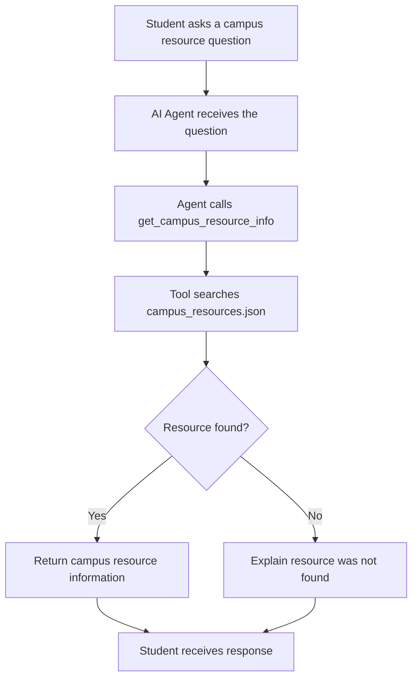

 # Agent Lab Part 2 — Design Notes

## Question 1: Understanding the Problem

The Student Services office wants an interface where students can easily find information about services offered at the college. This includes library hours, office hours, locations, contact information, and email addresses. Instead of searching through different websites, students can ask questions and get the information they need in one place.

## Question 2: Why Can't Gemini Answer These Questions by Itself?

An LLM like Gemini can answer general questions because it has been trained on large amounts of information. However, it may not have access to private, local, or frequently updated campus information. This is why it needs an agent with a tool that can access local files containing verified information about the college.

## Question 3: Why Use a JSON File Instead of Putting the Data in Python?

There are several reasons for storing the information in a JSON file instead of directly in the Python function. First, JSON is human-readable, making the information easier to understand and update. Second, it separates the data from the program code, so changes can be made without changing how the program works. Third, it allows the information to be reviewed independently and prepares the project for future growth, such as connecting to a database.

## Question 4: Three Limitations and Possible Improvements

**1. Information can become outdated.**

Office hours, locations, and contact information can change. One way to improve this would be to regularly verify the information against the college website and update the JSON file.

**2. The agent may not always use the tool correctly.**

Since AI does not always respond the same way, the agent might answer a question without checking the JSON file. We can improve this by giving the agent clear instructions and testing it to make sure it uses the tool when needed.

**3. The system does not remember past conversations permanently.**

The current version does not save conversation history in a database. In the future, we could improve this by adding a system that stores conversation history so students can continue previous conversations.

## Question 5: What Happens if the JSON Information Is Incorrect?

If the information in the JSON file is inaccurate, the agent could give students incorrect office hours, locations, or contact information. This would make the agent unreliable and less useful. Humans should be responsible for checking and verifying the information rather than depending on the AI to determine whether it is correct. The people responsible for maintaining the campus information should verify it and sign off on it before it is used.

## JCC Campus Resource Research

| Resource | Location | Hours | Phone | Email | Website | Verified By | Date Verified |
|---|---|---|---|---|---|---|---|
| Hultquist Library | HULT, Jamestown Campus | Check current library schedule | 716-338-1008 | Not confirmed | https://www.sunyjcc.edu/support/learning-commons/library | JCC website | Oct. 9, 2026 |
| IT Help Desk | Jamestown Campus, room not confirmed | Mon-Fri, 8:30 AM-4:30 PM | 716-338-1122 | JCCHelpDesk@sunyjcc.edu | https://www.sunyjcc.edu/support/technology/myjcc | JCC website | Oct. 9, 2026 |
| Learning Center (Tutoring) | HULT, Floor 1 | Contact office | 716-338-1008 | Not listed | https://www.sunyjcc.edu/support/learning-commons/learning-center | Needs verification | Not yet verified |
| Success Center (Advising) | COCE, Floor 1 | Contact office | 716-338-1065 | successcenter@mail.sunyjcc.edu | https://sunyjcc.edu/support/counseling/staff | Needs verification | Not yet verified |
| Financial Aid and Billing | COCE, Floor 1 | Contact office | 716-338-1009 | FinancialAid@sunyjcc.edu | https://www.sunyjcc.edu/support/financial-aid-billing/scholarships | Needs verification | Not yet verified |
| Career Services | Jamestown Campus | Contact office | 716-338-1061 | Not listed | https://www.sunyjcc.edu/support/career-services/interest | Needs verification | Not yet verified |
## Agent Workflow Diagram 

    